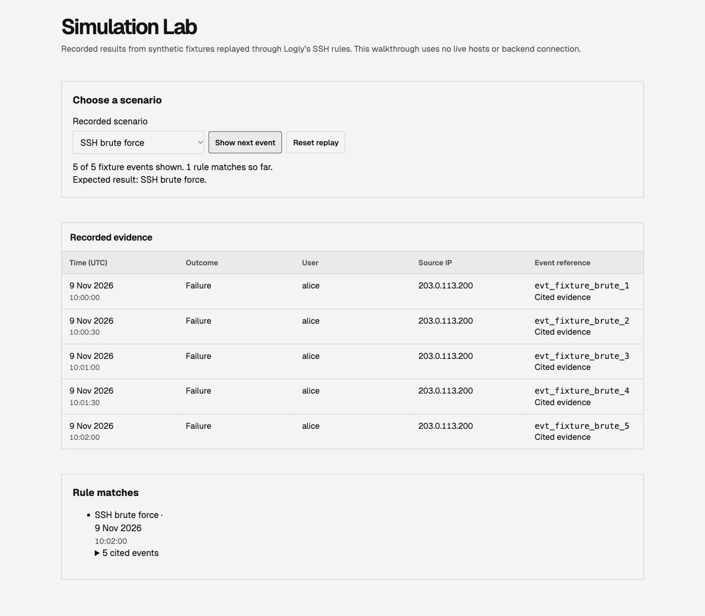
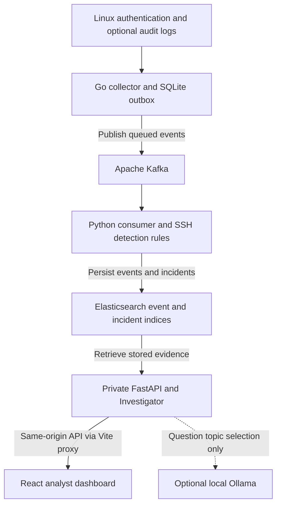

# Logly v2.0

Logly is a distributed Linux security monitoring and incident investigation system. It collects host telemetry, correlates SSH activity into incidents, and lets analysts trace each detection to its source events in a React dashboard. Durable collection checkpoints and replay-safe ingestion keep events recoverable when Kafka or Elasticsearch is temporarily unavailable.

**[Try the live Simulation Lab](https://joemon24.github.io/Logly/lab.html)** · **[Browse the GitHub repository](https://github.com/Joemon24/Logly)**

## Try the demo

| Experience | What runs |
| --- | --- |
| **Public Simulation Lab** | GitHub Pages serves four recorded replays generated from synthetic fixtures. Step through SSH brute force, password spraying, suspicious login success, or benign activity and inspect the rule matches and cited events. The browser uses bundled data with no connection to live hosts or backend services. |
| **Full local system** | Go collectors read host logs. Kafka carries events to the Python consumer, which stores events and incidents in Elasticsearch. A private FastAPI service powers event search, incident timelines, host history, and the Investigator. Local Ollama is optional. |

Start with **SSH brute force** to see how five authentication failures become one rule match. Then try **Benign authentication** to see a replay without a match.

## Screenshot



*The deployed Lab after replaying the five-event SSH brute-force fixture.*

## Architecture



- **Durable collection.** The Go agent persists source generations, file checkpoints, and pending events in SQLite. An event leaves the outbox after Kafka acknowledges it.
- **Replay-safe ingestion.** Stable event IDs support deduplication in Elasticsearch. The Python consumer commits Kafka offsets after the required writes and incident analysis succeed.
- **Evidence-linked detection.** Deterministic SSH rules identify brute force, password spraying, and a suspicious successful login following failures. Incident timelines reference the events that supported the finding.
- **Broader telemetry.** Supported sudo and account events can be collected from authentication logs. Optional audit logs add selected process executions and watched-file access. These categories are searchable, while the incident rules above are SSH-specific.

### AI-assisted investigation

The read-only Investigator uses stored evidence to reproduce an incident rule where possible, link citations to event rows, and flag missing evidence. It can surface host history, related incidents, and suggested next steps. With `LOGLY_OLLAMA_MODEL` configured, local Ollama classifies the analyst’s question into a supported topic. Python retrieves the records and renders the findings and citations. Ollama receives the question without log text or storage access. If the model is unavailable or returns an unsupported topic, deterministic routing takes over.

## Verified results

| Check | Recorded result |
| --- | --- |
| Docker-backed integration on macOS | **53 passed, 0 failed** across 14 scenarios, including broker outage, restart, deduplication, and Elasticsearch recovery |
| Python | **59 tests passed**, plus **16 passing subtests** |
| Go | **106 top-level tests passed** with the race detector across 8 test packages. `go vet` passed. |
| Frontend | **10 tests passed**. Lint, type checks, and both production builds passed. |
| npm audit | **0 vulnerabilities** reported in the verification run |

The outage test confirmed that a failed Elasticsearch write left the Kafka offset uncommitted. After recovery, the consumer stored one copy and committed offset 1 with zero lag. See the [real-stack verification procedure](docs/V2-INTEGRATION-VERIFICATION.md).

## Run locally

Use Python 3.12 or 3.13, Go 1.23+, Node.js 24, and Docker Compose. From the repository root, create the Python environment and run the v2 stack verification:

```sh
python3 -m venv .venv
. .venv/bin/activate
pip install -r central-server-py/requirements.txt
PYTHON="$PWD/.venv/bin/python" bash scripts/verify-v2-integration.sh
```

Use a dedicated local test environment. The suite restarts Kafka and Elasticsearch to verify outage recovery, leaves synthetic test records, and starts its own v2 agent and consumer. The default Compose detector is configured for v1. For a persistent v2 setup, follow the [completion guide](docs/V2-COMPLETION.md).

With Elasticsearch reachable on loopback, start the API and dashboard in separate terminals from the repository root:

```sh
cd central-server-py
ES_HOST=http://127.0.0.1:9200 ../.venv/bin/python -m uvicorn api.main:app --host 127.0.0.1 --port 8000
```

```sh
cd frontend
npm ci
npm run dev
```

For a local copy of the static demo:

```sh
cd frontend
npm ci
npm run build:lab
python3 -m http.server 4173 --bind 127.0.0.1 --directory dist-lab
```

Open [localhost:4173/lab.html](http://127.0.0.1:4173/lab.html).

### Test individual components

Run each block from the repository root after installing its dependencies.

```sh
PYTHONPATH=central-server-py .venv/bin/python -m unittest discover -s central-server-py/tests -v
```

```sh
cd agent
go test -race ./...
go vet ./...
```

```sh
cd frontend
npm run lint
npm run typecheck
npm test
npm run build
npm run build:lab
npm audit
```

## Technology stack

| Layer | Tools |
| --- | --- |
| Collection and local persistence | Go, SQLite |
| Streaming, detection, and search | Apache Kafka, Python, Elasticsearch |
| API and dashboard | FastAPI, React, TypeScript, Vite |
| Investigation and experiments | Ollama (optional), scikit-learn (offline experiment) |
| Local stack and demo hosting | Docker Compose, GitHub Actions, GitHub Pages |

## Current limitations

- **Ubuntu validation:** Live auditd, systemd, and file-watch operation still need verification on Ubuntu. The real-stack checks ran on macOS with fixture data.
- **Anomaly detection:** Isolation Forest is experimental and runs offline. It has no effect on incident decisions, and accuracy on representative data is unmeasured.
- **LLM evaluation:** Local Ollama routing was smoke-tested on five questions. Broader routing and investigation quality have yet to be measured.
- **Deployment boundary:** FastAPI is unauthenticated and intended for private development only. Keep it and the development data services on a trusted local network.

## Documentation

- [Completion guide and v2 setup](docs/V2-COMPLETION.md)
- [Go agent runtime](docs/AGENT-V2-RUNTIME.md) and [event schema](docs/AGENT-SCHEMA-V2.md)
- [Python delivery and deduplication](docs/PYTHON-CONSUMER-V2.md)
- [Incident rules and evidence](docs/INCIDENT-INTELLIGENCE.md)
- [Ubuntu validation](docs/LINUX-DEPLOYMENT.md) and [dashboard development](frontend/README.md)
